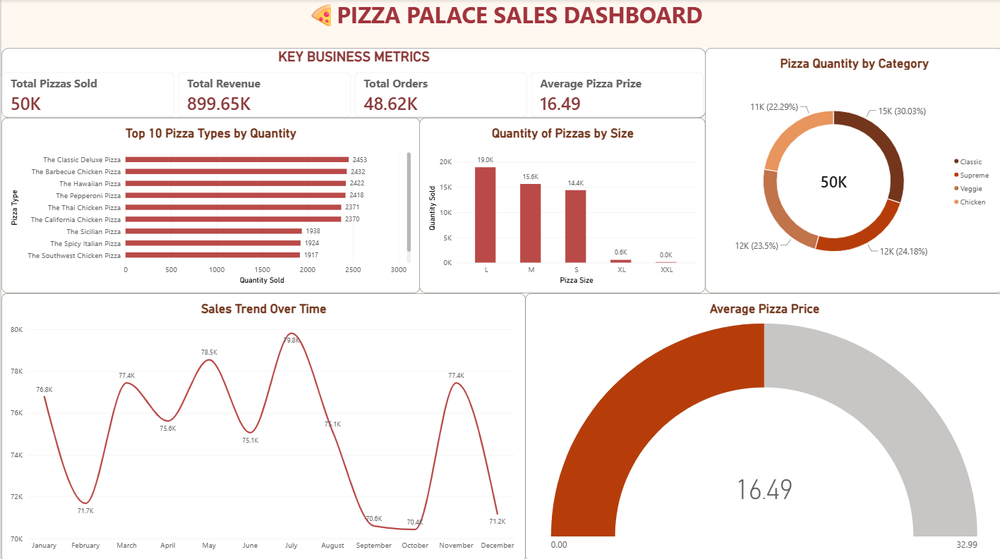

# 🍕 Pizza Palace Sales Dashboard

## Project Overview
An interactive Power BI dashboard designed to analyze Pizza Palace sales performance and present key business metrics.

## Tools Used
- Microsoft Power BI
- Data Visualization
- Business Intelligence

## Key Performance Indicators
- Total Pizzas Sold
- Total Revenue
- Total Orders
- Average Pizza Price

## Dashboard Insights
- Top 10 pizza types by quantity sold
- Pizza quantity by size
- Sales distribution by category
- Monthly sales trends
- Average pizza price

## Dashboard Preview

## Objective
To visualize sales performance, identify popular pizza types and sizes, and explore monthly sales trends to support business decisions.
